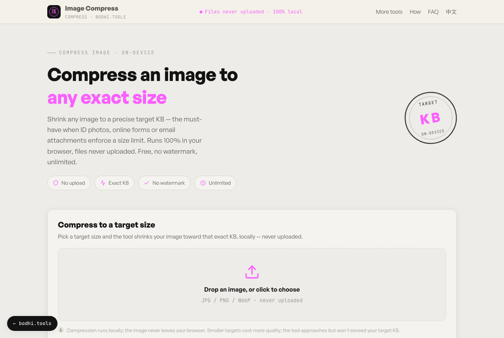

# Image Compressor

**English** · [简体中文](README.zh-CN.md)

Compress a JPG, PNG or WebP image to a target file size (20 KB, 50 KB, 100 KB or any number you type) without uploading it anywhere. Built for ID-photo uploads, application forms and email attachments that enforce a size limit.

**Try it:** https://compress.bodhi.tools/en/



## Features

- Target presets for 20, 50, 100, 200 and 500 KB, or any custom KB value
- Reduces quality and resolution step by step until the file reaches the target
- Retries as JPEG when a PNG or WebP can't get small enough
- Shows the before and after size, and names the download `photo-100kb.jpg`
- Compresses in a Web Worker, so the page stays responsive
- No watermark, no signup, no usage limits
- English and Simplified Chinese interface

## How it works

[browser-image-compression](https://github.com/Donaldcwl/browser-image-compression) decodes the image on a canvas and re-encodes it, reducing quality and dimensions until the output fits the target. If the library runs out of iterations first, the tool keeps compressing from its last result. The output never exceeds the target: the tool counts 1 KB as 1,000 bytes, so the file also passes forms that count 1 KB as 1,024 bytes. If an image can't get that small, the tool says so and shows the smallest size it reached.

## Privacy

- Your image is read and processed in your browser. The app has no upload endpoint.
- The page loads the compression worker script from jsDelivr and fonts from Google Fonts and Fontshare.
- The hosted site at compress.bodhi.tools uses Cloudflare Web Analytics, which counts page views without cookies. If you self-host and don't want it, delete the `cloudflareinsights` script tag in `index.html` and `en/index.html`.

## Run it locally

Requires Node.js 20.19+ (or 22.12+) and [pnpm](https://pnpm.io).

```bash
git clone https://github.com/bodhi1425/image-compressor.git
cd image-compressor
pnpm install
pnpm dev     # http://localhost:5173
pnpm build   # static site in dist/
```

`dist/` contains only static files. Host it on Cloudflare Pages, Netlify, GitHub Pages or any web server.

## Project layout

```
index.html       Chinese page (/)
en/index.html    English page (/en/)
src/main.ts      UI and compression logic
src/style.css    Styles
public/          favicon, robots.txt, sitemap.xml
```

## Built with

| Package | Used for | License |
|---|---|---|
| [browser-image-compression](https://github.com/Donaldcwl/browser-image-compression) | Image compression | MIT |
| [Vite](https://vite.dev), [TypeScript](https://www.typescriptlang.org) | Build | MIT, Apache-2.0 |

## More privacy-first tools

Each one runs entirely in your browser:

- [local-pdf-toolbox](https://github.com/bodhi1425/local-pdf-toolbox): merge, split, compress and convert PDFs
- [heic-converter](https://github.com/bodhi1425/heic-converter): convert iPhone HEIC photos to JPG or PNG
- [qrcode](https://github.com/bodhi1425/qrcode): QR codes with logos, gradients, Wi-Fi and vCard
- [ocr](https://github.com/bodhi1425/ocr): extract text from images
- [cutout](https://github.com/bodhi1425/cutout): remove image backgrounds with an on-device AI model

## Contributing

Bug reports and pull requests are welcome. Please open an issue first for larger changes.

## License

[MIT](LICENSE) © 2026 bodhi1425
